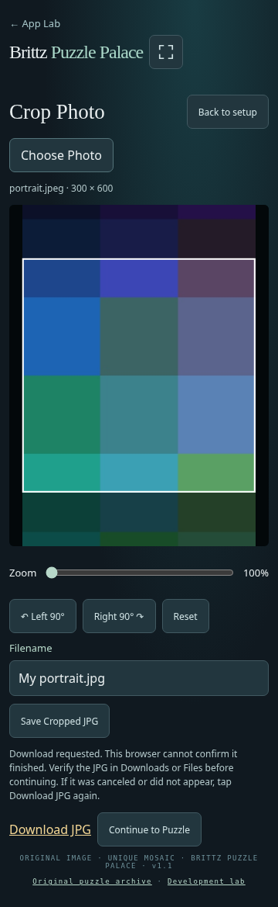
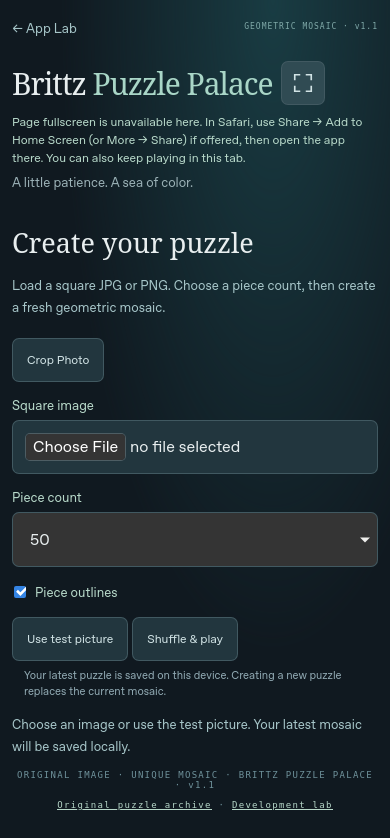

# v1.1 photo cropper and fullscreen

The main setup picker decodes the selected image with native orientation handling. Square JPG/PNG images remain ready without cropping. Non-square photos automatically open the cropper already loaded. **Crop Photo** remains available to crop or reframe square images manually. The dedicated `#crop-photo` view stays in the same document so the original image, edit state and cropped JPG can remain in memory. Browser Back and **Back to setup** return to setup without changing the saved puzzle. A direct `brittz-puzzle-palace/#crop-photo` link also opens the crop view after normal startup/resume completes.

## Framing and export

1. **Choose Photo** accepts images the browser can decode (JPG, PNG, WebP and other platform-supported formats). The limit is 32 MB / 64 megapixels. Unsupported or corrupt images show an error; if a previous photo exists, it remains visible and is identified explicitly.
2. Drag under the fixed, centered square. The Zoom range controls relative magnification from 1× cover to 5×; the buttons rotate exactly 90° left/right. **Reset** restores centered, minimum-cover framing and the original decoded orientation. Arrow keys also move the photo.
3. Edit the filename. It starts with the original basename plus `-cropped.jpg`; export sanitizes path/control characters and uses a JPG extension. The source File/photograph is never written, renamed or overwritten by the app.
4. **Save cropped JPG** renders a new **1024 × 1024** JPEG at quality .95 directly from the decoded original. There are no intermediate resized tiles. Transparent source pixels composite over white. The preview and export use the identical transform, with EXIF orientation handled by the browser's native image decoder.
5. The app requests a normal browser download and offers **Download JPG** to retry. It says **Download requested**, never **Saved**: browsers provide no reliable completion/cancellation notification to page scripts. Check Downloads/Files before choosing **Continue to Puzzle**. Where a browser opens an image preview instead, use its save/download action and return to the crop page. Editing the framing, photo or filename hides Continue to Puzzle until another export is requested.
6. **Continue to Puzzle** transfers the prepared JPG File directly to the normal setup image-selection path. No filesystem search or second selection is needed. Choose 50/100/150/200 and press the existing **Shuffle & play** to generate cuts. Continue to Puzzle itself never starts a game, writes a puzzle save, or generates geometry. It removes the crop URL fragment without navigating back to another document, so a crop-page reload/Back cache cannot discard the new in-memory selection.

The crop and handoff are in-memory only. Reloading or discarding the tab before Shuffle & play loses this temporary preparation; the downloaded JPG remains the recovery option. The current IndexedDB puzzle remains unchanged until the user explicitly creates another puzzle through Shuffle & play. Main/lab storage, geometry, certificates and controls retain their v1.0 behavior.

## Geometry and input

`crop-math.js` treats the crop as a fixed unit square. The displayed source uses `zoom / min(naturalWidth,naturalHeight)` scale. Quarter turns swap its axis extents. Translation clamps independently to half of each scaled extent minus the unit square, so all four crop corners always lie inside the photo. Zoom is centered on the crop; rotations transform both the photo and its offset about that same center. Framing is independent of preview size and device-pixel ratio.

`cropper.js` uses standard Pointer Events/pointer capture for relative drags, with cancellation/lift handling. The preview has `touch-action:none`; surrounding controls/page space still scroll normally. The native range and 44px buttons work with touch and keyboard. The preview canvas uses up to 2× device pixels; the export always draws once from the original to 1024px, with high-quality smoothing. The encoder canvas stays alive until serialization completes and then releases its backing buffer. The prepared File owns a copy of the encoded bytes independently of temporary encoder/download storage. Blob URLs remain alive during this visit, including retry/cancellation and the handoff, and are released on non-bfcache page exit.

`setup.js` coordinates the view only after the existing setup/resume promise. The small additive `chooseSetupImage()` export in `cutting/lab.js` calls the existing square-image validator and sets the file field where supported. If a browser cannot populate a native FileList, the ready message identifies the in-memory selection and Shuffle still uses that File. The resume path also materializes a byte-identical in-memory source Blob before creating its image URL, keeping it independent of the old IndexedDB backing file when a later Shuffle replaces that entry. No generator, clipping, snapping, control, IndexedDB schema, original SVG archive or other application code changes are required.

## Fullscreen investigation and behavior

The merged v1.0 source contained no in-app Brittz fullscreen button or fullscreen implementation. v1.1 supplies the box icon immediately after the title with an explicit **44 × 44px** target. The compact phone title spacing accommodates the target without shrinking the canvas or precision controls.

`fullscreen.js` detects actual page capabilities rather than deciding support from the browser name:

- Standard `requestFullscreen` / `exitFullscreen`, respecting `fullscreenEnabled`.
- The page-capable `webkitRequestFullscreen` / `webkitExitFullscreen` pair where available (for example, older iPad Safari), respecting its enabled flag.
- No video-only `webkitEnterFullscreen` call, orientation lock, simulated fullscreen, or unsupported API call.

The icon stays visible when fullscreen is unavailable. It then toggles an explanation; on iPhone/iPad (including touch-capable desktop-mode iPad user agents), it points to Safari's Share / Add to Home Screen option when offered. The main page includes the Apple standalone web-app capability meta tag. Other browsers get generic full-screen/Home Screen advice. The app remains playable in a normal tab.

Actual fullscreen change events update the accessible Enter/Exit label and pressed state, including browser-driven exits. Rejected requests show a non-blocking explanation and re-enable the button. Support can vary with Safari/OS version, private browsing, embedded-view permissions and installed/Home Screen context; the capability test makes no unsupported calls.

## Automated checks

```sh
node brittz-puzzle-palace/cropper.test.mjs
python brittz-puzzle-palace/check_cropper.py
# With Playwright WebKit installed (and its normal Linux runtime dependencies):
CROP_WEBKIT=1 python brittz-puzzle-palace/check_cropper.py
# Optional engine-only run:
CROP_WEBKIT=1 CROP_ENGINE=webkit python brittz-puzzle-palace/check_cropper.py
```

The unit tests cover extreme portrait/landscape/square aspect ratios, repeated drags/zooms/quarter turns, all crop-corner coverage, immutable state, filenames and standard/prefixed/unavailable fullscreen branches.

The browser suite uses generated color-block fixtures so independent source coordinates and downloaded JPG pixels can be checked. It covers:

- Chromium desktop and **320/360/390px Android-style touch** layouts; WebKit **390px iPhone-like** and **768px iPad-like** layouts.
- Portrait, landscape, square WebP and EXIF-oriented JPEGs; drag bounds, zoom/reset/90° rotation, square output matching the preview, edge coverage and unmodified original bytes.
- Download initiation, cancellation/retry wording, failed canvas export and corrupt-file recovery; editing invalidates Continue to Puzzle.
- Browser Back/direct crop links, in-memory handoff without geometry generation, all four difficulties, exact existing-save protection and reloads.
- Header button position/touch size, actual native Chromium fullscreen entry/exit, prefixed API dispatch, unsupported iPhone help with zero fullscreen calls, rejected requests and no horizontal overflow.

Chromium mobile drags use native CDP touch sequences. WebKit tests use native touchscreen taps for buttons and preview contact, plus mouse Pointer Event drags; Playwright's WebKit touchscreen interface does not expose native drag sequences. Real iPhone/iPad finger drags, OS file pickers/download/share UI and Home Screen behavior therefore still need physical-device verification. HEIC/other formats depend on that browser/OS decoder.

This environment ran Linux Playwright WebKit 26.5 using temporary browser/runtime libraries outside the repository. Its nonpersistent private-style contexts rejected even plain Blob IndexedDB writes; persistent isolated profiles supported the complete flow and are used by the suite. This is a test-runtime limitation, not a claim about every Safari private-browsing version. Physical Safari storage/private-mode behavior remains a device check. Application storage failure handling is unchanged.

Existing main-app, geometry, image-fidelity, precision-control, persistence, certificate and archival-integrity tests remain listed in [README.md](README.md). No runtime dependencies were added.

## Review screenshots

Synthetic color-block photos are used for reproducible framing/pixel tests; no user photos are included.





Automatic-selection routing is transactional: decoding and cropping do not replace the current setup image. Cancel/Back restores its ready message and file selection, and invalid files retain it. Only Continue to Puzzle accepts the exported JPG; only Shuffle & play replaces the saved puzzle. Regressions cover empty/prior selection cancellation, square readiness, portrait/landscape/EXIF automatic loading, manual square reframing and save/continue on Chromium and persistent WebKit profiles.
