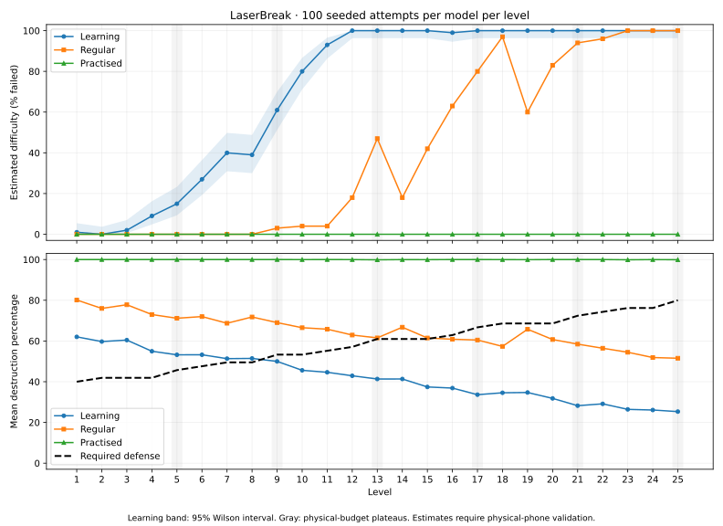

# LaserBreak — 10-level Arcade progression report

Configuration and results are generated from `arcade.js` and [arcade-simulation.json](arcade-simulation.json). The primary run uses **100 seeded attempts per level per model**, **3,000 attempts total**, a **1000 × 573** logical field, and **60 Hz** simulation. This approximates the central field of an 844×390 landscape phone after the existing pads/header. It is an estimate, not a physical-phone validation.

## Generated levels

| Level | Budget | Seconds | Target Ø | Target fall | Bar length | Bar fall | Rotation °/s | Density % | Bars % | Cooldown s | Blast × | Required |
| --- | --- | --- | --- | --- | --- | --- | --- | --- | --- | --- | --- | --- |
| 1 | 0 | 45 | 40 | 50.00 | 100 | 35.00 | 45 | 20 | 20 | 0.75 | 3 | 18 |
| 2 | 1 | 45 | 40 | 51.00 | 100 | 35.70 | 45 | 23 | 20 | 0.75 | 3 | 20 |
| 3 | 2 | 45 | 40 | 52.02 | 100 | 36.41 | 45 | 23 | 30 | 0.75 | 3 | 18 |
| 4 | 3 | 45 | 38 | 53.06 | 100 | 37.14 | 45 | 23 | 30 | 0.75 | 3 | 18 |
| 5 | 3 | 45 | 38 | 54.12 | 100 | 37.89 | 45 | 23 | 30 | 0.75 | 3 | 18 |
| 6 | 4 | 45 | 38 | 55.20 | 100 | 38.64 | 53 | 23 | 30 | 0.75 | 3 | 18 |
| 7 | 5 | 45 | 38 | 56.31 | 100 | 39.42 | 53 | 26 | 30 | 0.75 | 3 | 20 |
| 8 | 6 | 45 | 38 | 57.43 | 100 | 40.20 | 53 | 26 | 40 | 0.75 | 3 | 18 |
| 9 | 6 | 45 | 38 | 58.58 | 100 | 41.01 | 53 | 26 | 40 | 0.75 | 3 | 18 |
| 10 | 7 | 45 | 36 | 59.75 | 100 | 41.83 | 53 | 26 | 40 | 0.75 | 3 | 17 |

Sizes/speeds use logical pixels and logical pixels/second. Thickness remains 12. Sound/debug are user preferences, not difficulty inputs. Requirements need not rise numerically: more bars and smaller targets reduce attainable target supply, so the budget compensates instead of simply increasing every requirement.

## Central formulas

For positive integer level `L`, let `n = L − 1`, `b = n − floor(n / 4)`, and `p(j) = floor(b / 4) + indicator(b mod 4 > j)` for axes `j = 0..3`. Every 4th step adds no extra budget point. Falling speeds still rise; the plateau is in the other parameters.

- Target speed: `min(140, 50 × 1.02^n)`; bar speed: `min(110, 35 × 1.02^n)`.
- Density: `min(60, 20 + 3 × p(0))`.
- Bar percentage: `min(60, 20 + 10 × p(1))`, compatible with ten-entry bags.
- Target diameter: `max(24, 40 − 2 × p(2))`.
- Bar rotation: `min(140, 45 + 8 × p(3))`.
- Bar length 100, cooldown 0.75, blast multiplier 3, duration 45 remain constant in this first progression.
- Let `rate = 0.05 + 5.95 × density / 100` and `S = 45 × rate × 0.8 × ((1 − bars / 100) / 0.8)^0.8`.
- Let `capture = min(0.62, 0.40 + 0.001 × b)`.
- Required targets: `max(1, round(S × capture × (diameter / 40)^0.8))`.

`S` is a supply heuristic, not a promise of accepted spawns: occupied entry slots can skip attempts. The bar exponent and precision factor temper the quota when aiming/obstruction gets harder. Budget allocation changes only one extra axis per step; there are no individual level overrides or scripted positions/waves. All constants, bounds, duration, count, and the testing-feature flag live in `CONFIG`. `generateLevel()` is pure and bounded through Level 50 in tests. To extend the playable count, change `CONFIG.levelCount` and rerun simulations/report; future levels have not been phone-balanced.

## Player models and method

| Model | Reaction / aiming delay | Post-shot wait | Endpoint σ | Motion prediction | Strategy | Bar forecasting |
| --- | --- | --- | --- | --- | --- | --- |
| Learning | 0.65 s | 1.25 s | 16 px | 50% | urgent | 0% |
| Regular | 0.5 s | 1.1 s | 14 px | 65% | cluster | 45% |
| Practised | 0.22 s | 0.8 s | 5 px | 100% | cluster | 100% |

Each model observes targets, waits its reaction delay, then fires; the post-shot wait precedes the next observation. Gaussian endpoint errors are independent. Learning picks the lowest visible target with horizontal aim. Regular scores clusters among up to eight visible candidates with approximate bar prediction. Practised also tries three slopes with accurate motion prediction. No model has a prescribed spawn sequence. Seeds are shared across models for each level/trial, but destruction and placement retries naturally diverge.

The harness calls the production World, generator, and ArcadeSession. It omits only cosmetic particles/effect storage and audio/rendering. It models release timing rather than physically moving two simulated fingers; real Pointer Events are covered by browser tests. Targets count from the actual destroyed set; blocked shots are successful firing actions where at least one beam reaches a bar. A blocked shot can still destroy targets from the other side, so it is not synonymous with a miss. Each attempt runs the full 45 seconds even after reaching its requirement.

## Estimated difficulty



The graph uses `100 × (1 − completion rate)` as estimated difficulty. The Learning band is a 95% Wilson interval; near 50%, 100 attempts leave roughly ±10 percentage points of uncertainty. A 100/100 outcome still has a lower confidence bound around 96%, rather than proving certainty.

## Simulation results

| Level | Model | Completed | Mean targets | Mean shots | Mean blocked shots | Target range |
| --- | --- | --- | --- | --- | --- | --- |
| 1 | Learning | 94% | 21.77 | 23.90 | 9.59 | 12–30 |
| 1 | Regular | 100% | 28.51 | 27.97 | 5.23 | 21–34 |
| 1 | Practised | 100% | 44.80 | 41.07 | 13.14 | 43–46 |
| 2 | Learning | 94% | 24.05 | 23.98 | 10.16 | 18–30 |
| 2 | Regular | 100% | 31.25 | 27.98 | 5.41 | 26–38 |
| 2 | Practised | 100% | 50.41 | 42.38 | 12.44 | 49–53 |
| 3 | Learning | 93% | 21.36 | 23.94 | 13.98 | 13–27 |
| 3 | Regular | 100% | 28.45 | 27.94 | 9.54 | 22–34 |
| 3 | Practised | 100% | 44.17 | 41.19 | 19.50 | 42–46 |
| 4 | Learning | 78% | 19.65 | 23.96 | 13.39 | 14–26 |
| 4 | Regular | 100% | 26.79 | 27.95 | 8.89 | 22–32 |
| 4 | Practised | 100% | 44.20 | 41.34 | 19.09 | 42–46 |
| 5 | Learning | 75% | 19.02 | 23.96 | 13.54 | 12–26 |
| 5 | Regular | 100% | 26.20 | 27.95 | 9.18 | 21–31 |
| 5 | Practised | 100% | 44.22 | 41.16 | 18.08 | 42–46 |
| 6 | Learning | 73% | 19.20 | 23.98 | 12.99 | 12–28 |
| 6 | Regular | 100% | 26.62 | 27.95 | 8.63 | 21–33 |
| 6 | Practised | 100% | 44.31 | 41.34 | 17.74 | 43–46 |
| 7 | Learning | 64% | 20.65 | 23.96 | 13.30 | 13–28 |
| 7 | Regular | 100% | 28.43 | 27.99 | 9.66 | 23–33 |
| 7 | Practised | 100% | 49.30 | 42.53 | 17.58 | 47–52 |
| 8 | Learning | 56% | 17.67 | 23.89 | 16.65 | 10–24 |
| 8 | Regular | 100% | 25.53 | 27.92 | 13.64 | 19–32 |
| 8 | Practised | 100% | 42.14 | 40.84 | 23.31 | 39–44 |
| 9 | Learning | 48% | 17.37 | 23.95 | 16.75 | 12–23 |
| 9 | Regular | 99% | 24.78 | 27.92 | 14.27 | 17–31 |
| 9 | Practised | 100% | 42.06 | 40.69 | 22.71 | 40–44 |
| 10 | Learning | 44% | 15.92 | 23.86 | 15.84 | 9–22 |
| 10 | Regular | 100% | 23.91 | 27.89 | 13.51 | 18–32 |
| 10 | Practised | 100% | 42.38 | 40.83 | 22.12 | 40–45 |

## Tuning and balance concerns

The initial requirement heuristic used `round(45 × rate × targetShare × (0.42 + 0.012 × budget))`. It over-penalized slower players when precision and obstruction increased. The final formula lowers capture growth and accounts for target size; the bar-supply exponent prevents a large quota drop from making a new bar step unexpectedly easy. The following counterfactual uses the **same final-run target histograms** against the original quotas. Quotas are checked only at the deadline, so changing them does not change the simulated shots/spawns. This isolates quota tuning from model or geometry changes.

| Level | Initial quota | Final quota | Learning completion with initial quota | Learning completion now |
| --- | --- | --- | --- | --- |
| 1 | 19 | 18 | 91% | 94% |
| 2 | 22 | 20 | 77% | 94% |
| 3 | 20 | 18 | 75% | 93% |
| 4 | 20 | 18 | 55% | 78% |
| 5 | 20 | 18 | 42% | 75% |
| 6 | 21 | 18 | 33% | 73% |
| 7 | 24 | 20 | 17% | 64% |
| 8 | 21 | 18 | 14% | 56% |
| 9 | 21 | 18 | 13% | 48% |
| 10 | 22 | 17 | 1% | 44% |

All ten requirements were attained by sampled models. The lowest observed completion rate is 44%; no below-10% model/level outcome occurred. These are feasibility estimates, not proofs.

- Level 4: Learning drops 15 percentage points; inspect this difficulty step on a phone.
- Regular/Practised results are near the ceiling: good clustering and prediction dominate this initial progression. The model suite can detect a slower-player curve but cannot resolve fine difficulty for highly accurate players.
- Spawn density can increase target supply as well as pressure. The supply-based quota counters this; it is why a numerical quota can rise on a density step and fall on a bar/precision step.
- Random samples and real aspect ratios matter. Longer/narrower logical fields change dwell time and bar obstruction; this report represents one common phone geometry.

## Recommendations

1. Phone-test Levels 1, 4, 7, 8, and 10 first with actual users. Tune the shared size step, capture fraction, or prediction assumptions if a reported spike is reproducible; avoid per-level exceptions.
2. Keep the temporary Level Select available for this review. Disable `CONFIG.testingLevelSelect` before release; it removes the testing UI/action without changing the generator.
3. Collect physical completion counts and rough shot rates before increasing quotas to challenge the ceiling models. Aiming prediction and symmetric independent errors are optimistic assumptions for human thumbs.
4. Repeat at other phone/tablet aspect ratios and slower rendering budgets. At stalls, the active Arcade clock remains accurate but motion/spawning deliberately do not catch up in bursts.
5. Expand beyond ten only after recalculating outcomes. Raise `CONFIG.levelCount` to 25/50, keep clamps, rerun the same harness, and inspect acceptance counts and precision demands.

## Reproduce

```sh
node laserbreak/simulate-arcade.cjs 100
python laserbreak/report-arcade.py
node laserbreak/test-arcade.cjs
```

The simulation needs Node only. Report/chart generation needs Python and matplotlib as development tools; the deployed application has no new dependencies. The JSON contains seeds-by-formula metadata, model/config snapshots, means, ranges, and target-count histograms. The SVG is a standalone exportable graph; a PNG preview is written to `/tmp/laserbreak-arcade-difficulty.png`.
